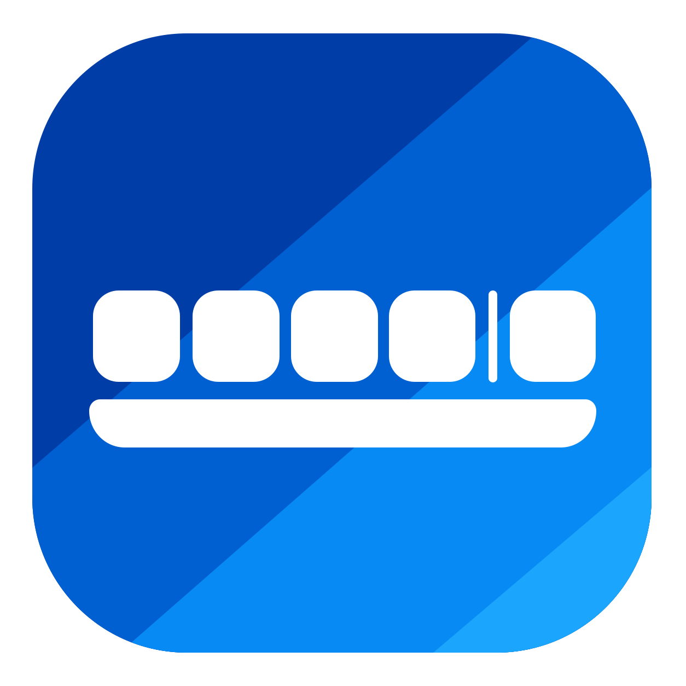
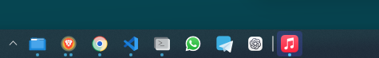
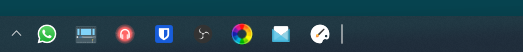
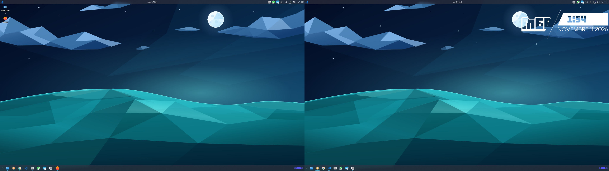

<div align="center">
  

  # Jonio Panel

  **La barra delle applicazioni ispirata a jonioOS Sila, realizzata per KDE Plasma 6.**

  App fissate organizzate in stack, finestre aperte, anteprime e menu applicazioni in un solo plasmoide QML.

  [](https://kde.org/plasma-desktop/)
  
  [](./LICENSE)

  [Anteprima](#anteprima) · [Installazione](#installazione) · [Come si usa](#come-si-usa) · [Impostazioni](#impostazioni)
</div>

---

## Anteprima

### Due stack, una rotellina

<div align="center">
  <strong>Stack 1 · app di ogni giorno</strong><br><br>
  <br><br>
  <strong>↕ Scorri con la rotellina sulle app fissate ↕</strong><br><br>
  <br><br>
  <strong>Stack 2 · altre app, stessa barra</strong>
</div>

<details>
<summary><strong>Apri lo screenshot completo dei due monitor · 3840 × 1080</strong></summary>

[](./assets/jonio-panel-desktop-3840x1080.png)

*Acquisizione reale alla risoluzione originale. Sfondo, tema e disposizione degli altri widget dipendono dalla configurazione di Plasma.*

</details>

## Perché Jonio Panel

Jonio Panel riunisce le app che usi ogni giorno a sinistra del separatore e le finestre aperte a destra. Può occupare lo spazio libero del pannello oppure restare compatto, lasciando gli altri widget all'estremità destra. La piccola freccia apre una griglia di applicazioni con ricerca.

| Funzione | Cosa offre |
| --- | --- |
| **Stack di app fissate** | Da 1 a 8 gruppi; la rotellina passa da uno all'altro con un'animazione. Con un solo stack, scorre le icone. |
| **Ordine personale** | Trascina le app fissate per riordinarle. La disposizione viene salvata nel widget. |
| **Finestre e anteprime** | Le app aperte mostrano indicatori e miniature; puoi attivare, ripristinare o chiudere una finestra dall'anteprima. |
| **Menu applicazioni** | Una griglia ricercabile permette di avviare un'app o fissarla nello stack corrente. |
| **Azioni rapide** | Il menu contestuale espone le azioni supportate dall'app, come percorsi di Dolphin o controlli multimediali. |
| **Più monitor** | Puoi mostrare tutte le finestre insieme oppure aggiungere un'istanza del widget a ogni pannello e filtrarla per monitor. |

> [!TIP]
> Gli stack organizzano le **app fissate**. Le finestre aperte continuano a comparire nella sezione dopo il separatore.

## Installazione

**Requisito:** KDE Plasma 6 con `kpackagetool6` disponibile nel sistema.

```bash
git clone https://github.com/jonioos/jonio-panel.git
cd jonio-panel
kpackagetool6 --type Plasma/Applet --install .
```

Apri **Modifica pannello** in Plasma, scegli **Aggiungi o gestisci oggetti** e inserisci **Barra delle applicazioni Jonio**. Posizionala prima degli oggetti che vuoi lasciare a destra.

Per aggiornare una copia già installata dalla cartella del progetto:

```bash
kpackagetool6 --type Plasma/Applet --upgrade .
```

<details>
<summary><strong>Il widget non compare subito nell'elenco?</strong></summary>

Riapri l'elenco degli oggetti di Plasma. Se necessario, termina la sessione e accedi di nuovo, oppure riavvia la shell con `systemctl --user restart plasma-plasmashell.service`.

</details>

## Come si usa

| Gesto | Risultato |
| --- | --- |
| **Clic sulla freccia** | Apre o chiude il menu con tutte le applicazioni. |
| **Digita nel campo di ricerca** | Filtra le applicazioni per nome. |
| **Clic sul `+` di un'app** | La fissa nello stack visibile; se è già fissata altrove, la sposta nello stack corrente. |
| **Rotellina sulle app fissate** | Cambia stack; con un solo stack, scorre le icone in orizzontale. |
| **Trascina un'app fissata** | Cambia la sua posizione nello stack. |
| **Clic sinistro su un'app** | La avvia, attiva o mostra le finestre del gruppo. |
| **Passa il mouse su un'app aperta** | Mostra le anteprime dopo il ritardo configurato. |
| **Clic su una miniatura / sulla sua X** | Attiva o chiude quella finestra. |
| **Clic centrale su un'app aperta** | Chiude la finestra o il gruppo. |
| **Clic destro su un'icona** | Apre le azioni disponibili per quell'app. |
| **Clic destro nello spazio vuoto** | Apre il menu di Plasma per configurare il widget. |

Le anteprime mostrano le finestre raggruppate e seguono l'icona sotto il mouse. Sul desktop, il passaggio sopra una miniatura evidenzia la finestra corrispondente. Durante il cambio di app, la vecchia anteprima resta visibile brevemente mentre viene preparata la nuova.

## Impostazioni

Apri **Configura Barra delle applicazioni Jonio** dal menu contestuale nello spazio vuoto del widget.

<details open>
<summary><strong>Aspetto e organizzazione</strong></summary>

- **Larghezza:** estendi il widget nello spazio libero del pannello o usa la larghezza compatta.
- **Icone:** regola dimensione e spazio tra gli elementi.
- **Stack:** scegli da 4 a 12 posizioni visibili e da 1 a 8 stack.
- **Indicatori:** barretta, pallino o un pallino per ogni finestra, con colore del tema o personalizzato.
- **Finestre:** scegli se raggruppare quelle della stessa applicazione.

</details>

<details>
<summary><strong>Anteprime e menu</strong></summary>

- Attiva o disattiva le anteprime al passaggio del mouse.
- Regola il ritardo prima dell'apertura da 100 a 2000 ms.
- Scegli se il menu applicazioni si chiude quando passi sopra un'icona della barra.

</details>

<details>
<summary><strong>Monitor, desktop e attività</strong></summary>

Per ciascuna categoria puoi mostrare tutte le finestre insieme o limitarti al monitor, desktop virtuale o attività correnti. Per barre indipendenti su più monitor, aggiungi Jonio Panel a ogni pannello e seleziona **Solo il monitor di questa barra** in ciascuna istanza.

</details>

## Note tecniche

Jonio Panel è un plasmoide QML per Plasma 6. Usa il modello dei processi di Plasma per app fissate e finestre, le miniature di Plasma su X11 e PipeWire su Wayland. Le anteprime vengono attivate quando servono e rilasciate alla chiusura del popup.

I file principali sono in [`contents/ui`](./contents/ui), le opzioni persistenti in [`contents/config/main.xml`](./contents/config/main.xml) e i metadati in [`metadata.json`](./metadata.json).

## Contribuire

Segnalazioni di bug e proposte di miglioramento sono benvenute nelle [issue del progetto](https://github.com/jonioos/jonio-panel/issues). Per una modifica al codice, descrivi il comportamento atteso e quello osservato, indica la versione di Plasma e specifica se usi Wayland o X11.

## Licenza

Distribuito secondo la [GNU GPL versione 2 o successiva](./LICENSE).
